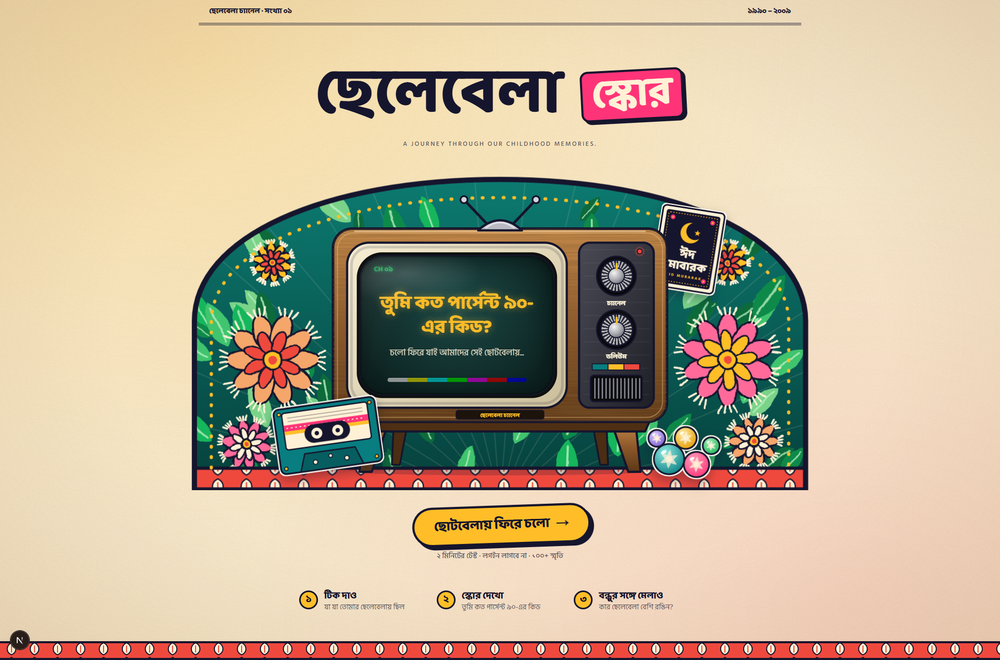

# Chhelebela Score



**Chhelebela Score** is a Bangla-first nostalgia quiz about growing up in Bangladesh during the 1990s and 2000s. Explore seven memory channels, answer the cards that feel familiar, and get a playful childhood score.

## What it includes

- Seven themed channels with 90s and 2000s memories
- Yes, skip, and untouched answers
- Channel completion with safe confirmation for unanswered cards
- Bangla scoring, era comparisons, and per-channel breakdowns
- Persistent progress in versioned local storage
- Result sharing through native share, WhatsApp, Facebook, or copy-to-clipboard
- Responsive mobile and desktop layouts
- Keyboard navigation and reduced-motion support
- Accessible TV controls, dialogs, labels, focus handling, and status text

## Run locally

Requirements:

- Node.js 20 or newer
- npm

```bash
npm install
npm run dev
```

Open [http://localhost:3000](http://localhost:3000).

## Available commands

```bash
npm run dev       # Start the development server
npm run build     # Create a production build
npm start         # Start the production server
npm run lint      # Run ESLint
npm test          # Run the Vitest suite
npx tsc --noEmit  # Check TypeScript
```

## Environment variables

`NEXT_PUBLIC_SITE_URL` is optional. When provided, it is used as the metadata base URL for Open Graph and Twitter cards. On Vercel, `VERCEL_PROJECT_PRODUCTION_URL` is used as a fallback; local development defaults to `http://localhost:3000`.

The social preview image is expected at `public/og.png` with a recommended size of `1200×630`.

## Scoring notes

- Only completed channels contribute to the score.
- Skipped memories are excluded from the denominator.
- Untouched memories count as “not experienced.”
- Memories shared by both eras contribute to both era percentages.
- Era comparisons are shown only when enough eligible memories are available.
- Results unlock after three completed channels.

## Tech stack

- Next.js App Router
- React and TypeScript
- Tailwind CSS 4
- Motion
- Vitest
- Canvas Confetti

## License

This project is currently intended as a personal project and does not yet include a separate license.
